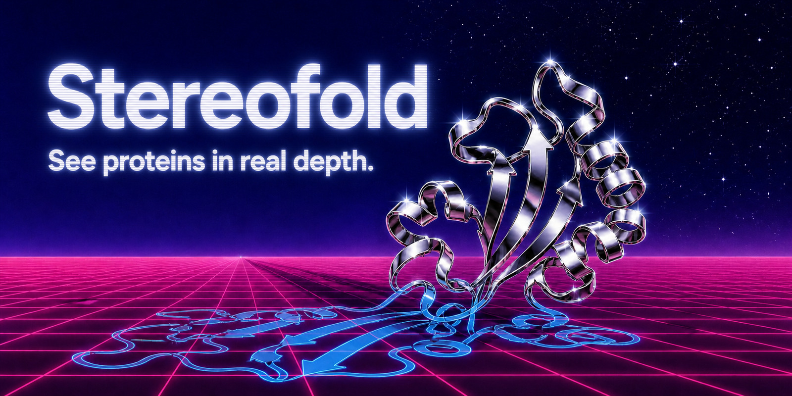
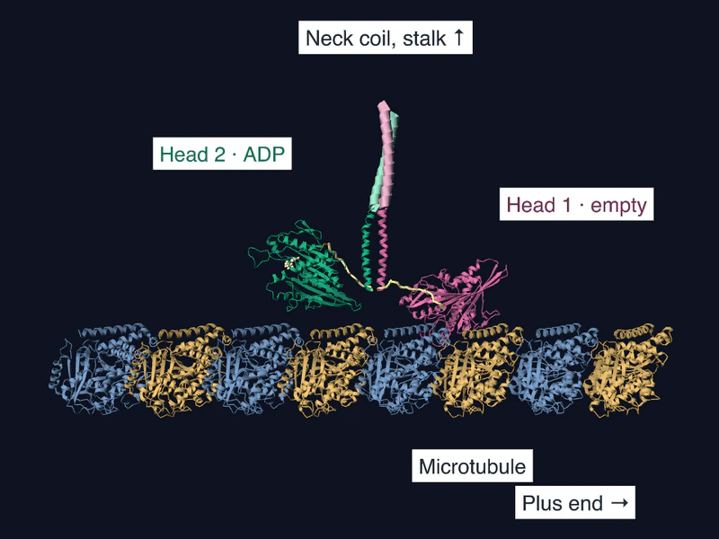
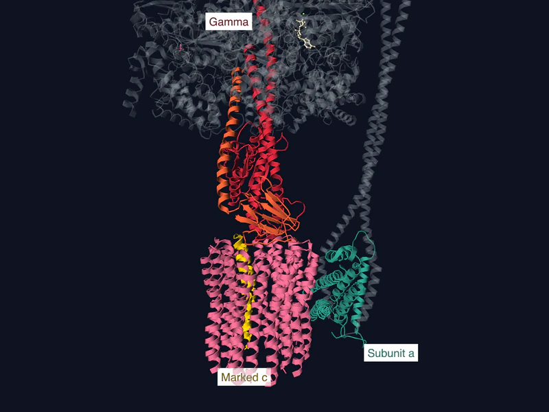
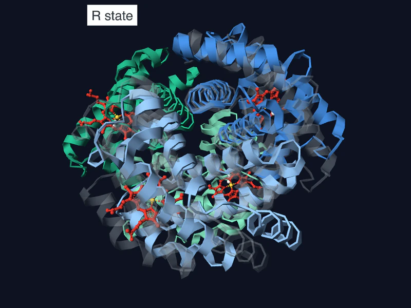
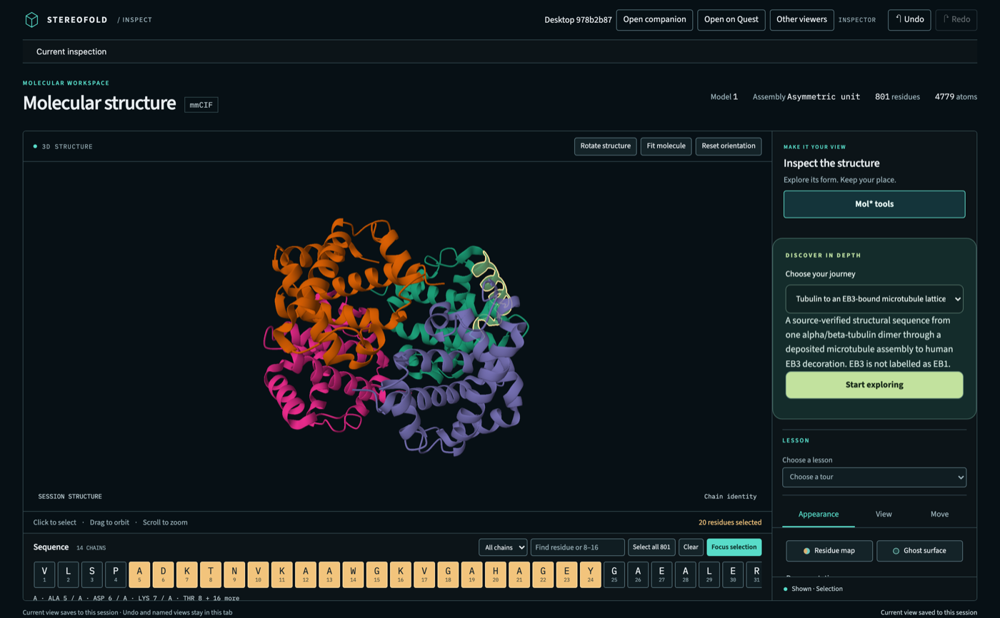
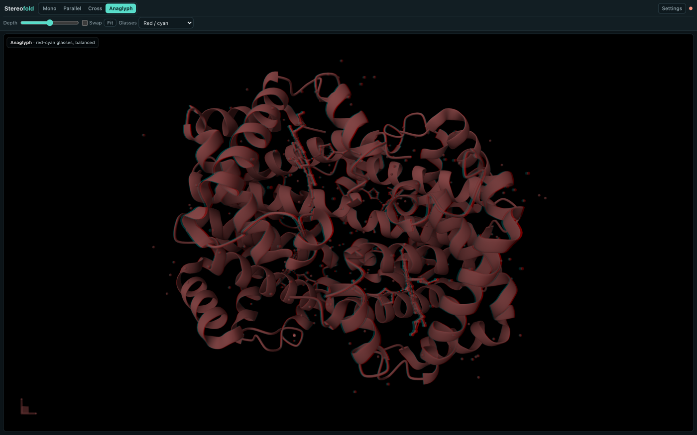

# Stereofold

Stereofold lets your AI agent open a molecular structure, share it with a
WebXR headset, and change it while you watch. It provides an MCP server and
skills for Claude Code, Claude Science, Codex CLI, and the Codex desktop app.

Bring the structure and question you're already working on. Your agent can
build a custom scene or lesson, send it to the headset, and keep changing it
as you explore. The bundled [demos](#demos) show a few examples.

[](LICENSE)
[](https://jvogan.github.io/stereofold/)

You ask the agent for a PDB entry or a local mmCIF file. The agent opens the
structure in a desktop Mol\* inspector and shares it with the headset's browser
over your private Wi-Fi. Type, dictate, or use your host's live voice chat to ask
for changes such as "color chain A red". Stereofold has been run on a
Quest 2 and in Safari in the visionOS 27 simulator; Quest 3, Quest 3S, Quest Pro
and a physical Vision Pro are untested.

Other headset browsers can pair over HTTPS. Meta and Apple have shortcuts for
opening the link. Your agent can use the generic connection for other devices,
inspect their WebXR modes and inputs, and use the features the browser exposes.
See the [headset quickstart](plugin/QUICKSTART.md) for this route.

Keep the conversation going in the same session:

- “Put the structure I'm working on into my headset.”
- “Highlight this ligand and bring its binding pocket closer.”
- “Make the protein transparent, keep the ligand solid, and stop the rotation.”
- “Show me the next scene, then let me explore it.”
- “Switch to hemoglobin without making me pair again.”

Your agent can inspect selections, apply scene changes, and confirm that the
connected viewer rendered them. Claude and Codex can join the same shared
session. Keep talking through your host's live voice chat when available, or
type and dictate in the same conversation. Headset microphone control is
optional. The [voice guide](docs/headset-walkthrough.md#talk-to-the-agent)
explains both routes.

The [website source](docs/) includes a crambin demo that runs in the browser
with no plugin install. Its publication address is the
[project page](https://jvogan.github.io/stereofold/). Watch the
[two-minute desktop walkthrough](https://jvogan.github.io/stereofold/walkthrough.html)
to see live scene edits and a molecular lesson.

## Demos

<p>
  
  
  
</p>

Ask for a demo by name. In Claude Science, finish the one-time
[setup](#claude-science), run `node plugin/dist/headset-host.mjs 4HHB` in a Mac
terminal, put the headset on, and ask:

> Join the Stereofold scene on this Mac and open the kinesin-walk demo.

In Claude Code or Codex, ask: “Open the kinesin-walk demo on my Quest.”

| Demo | What you see |
| --- | --- |
| `kinesin-walk` | Two kinesin heads trade the lead along a microtubule, 8.2 nm per step, then rest with both heads bound. |
| `atp-synthase-rotor` | The gamma stalk and a ring of ten c subunits turn under the catalytic head of ATP synthase, in three 120° steps per turn. |
| `hemoglobin-switch` | One alpha-beta pair of hemoglobin turns 14 degrees against the other into the R state, with O2 on every heme, then turns back. |
| `binder-gallery` | Seventeen designs meeting the published study's binding criteria, with toxin names and measured Adaptyv KD labels; an aligned comparison keeps each reference target fixed. |
| `binder-gallery-extended` | The same 17 first, then one representative intended-target pairing for each of the other 194 tested designs, in ten additional batches. |
| `microtubule-growth` | Say “grow it” and the next tier replaces the last: one tubulin, a dimer, a strand, then a wall three strands wide. |
| `crispr-cas9` | Cas9 with its guide RNA and both DNA strands; nine chapters name the guide, the PAM, the recognition lobe and the nucleases. |
| `telomerase-haca` | The RNA-protein lobe of human telomerase: nine proteins on one RNA, anchored by two dyskerin copies. |
| `spike` | The SARS-CoV-2 spike trimer, closed, turned on its long axis and shown as a surface. |
| `nucleosome` | 147 base pairs of DNA wrapped not quite twice around eight histones, then cut open to the core. |
| `daraxonrasib` | KRAS G12D and cyclophilin A held together by the drug, with its two contacts measured at 3.38 Å and 2.90 Å. |

The three moving demos have more stages: `flipbook` and `cycle` for
`kinesin-walk`, `flipbook` and `figure` for the other two. Name a stage to open
it, for example “Open the cycle stage of kinesin-walk.” Their authored rigid-body
paths illustrate motion; they are not measured trajectories. Coordinates download
from RCSB on first use, while the binder galleries ship their published predicted
coordinates. All coordinate sources must match the digests in
[`plugin/demos/index.json`](plugin/demos/index.json).
[`plugin/demos/README.md`](plugin/demos/README.md) lists every demo and stage,
and the [project page](https://jvogan.github.io/stereofold/#demos) shows animated
examples.

For the slideshow, ask: “Open binder-gallery-extended on my Quest, keep narration
off, use Room off for the white background, and play while preserving my
placement.” Each slide dwells for three seconds after rendering; loading adds
time between slides and batches. The first 17 are all study-qualified designs,
not a ranked top 17. Labels distinguish published measured Adaptyv KD (including
bounds and approximate fits) from computational prediction scores, and show
the other designs' actual assay outcomes. These are predicted complexes; binding does not establish toxin
neutralization. The galleries adapt Anthropic's pinned scorpion-toxin dataset
under CC BY 4.0; see [credits and structural-source terms](plugin/demos/binder-gallery/CREDITS.md)
and [extended selection and provenance](plugin/demos/binder-gallery/extended/README.md).

## Install

The tested desktop setup is macOS with Node.js 22 or newer. `node --version` prints yours;
[nodejs.org](https://nodejs.org/) has the installer. The built server is
committed to this repository, so you can run it without building.

### Use the checkout directly

Open this repository in your agent and ask it to set up Stereofold for your
host. [AGENTS.md](AGENTS.md) and [CLAUDE.md](CLAUDE.md) point to the full setup,
scene-control and presentation skills. The agent can register
`plugin/dist/server.mjs` with Codex, Claude Code or another local MCP host, then
open your molecule and configure the requested headset route. See
[direct source setup](docs/install.md#use-the-checkout-directly) for commands
and skill discovery outside this checkout.

The source workflow includes the full runtime and all three skills. The
portable lesson package contains only its planner and presentation skill.
Directory submission and packaged plugin installation are separate routes.

### Install a packaged plugin

Pick your host:

| Host | How to open the structure |
| --- | --- |
| [Claude Code](#claude-code) | Install the plugin; the server opens a browser inspector. |
| [Codex desktop app](#codex-cli-and-the-codex-app) | Install the plugin; use the embedded inspector or its browser fallback. |
| [Codex CLI](#codex-cli-and-the-codex-app) | Install the plugin; the server opens a browser inspector. |
| [Claude Science](#claude-science) | Register the local MCP server and join a terminal headset host. |

The server runs on Node.js. macOS provides the tested browser launch, clipboard,
and Apple Speech integrations. On another operating system, register the same
server, configure the available browser opener, and verify the requested route.

### Claude Code

```sh
claude plugin marketplace add jvogan/stereofold
claude plugin install stereofold@stereofold
```

Start a new `claude` session to load the plugin.

### Codex CLI and the Codex app

Install into the profile used by your Codex host:

```sh
codex plugin marketplace add https://github.com/jvogan/stereofold
codex plugin add stereofold@stereofold
```

If your shell has no `codex` command, install the Codex CLI or use the app's
plugin controls. Start a fresh conversation after installation. Your host's
permissions determine which tool calls require approval.

### Workspace and directory options

- ChatGPT workspace admins can [import this GitHub marketplace](docs/install.md#import-for-a-managed-workspace)
  and offer the full plugin to members in the ChatGPT desktop app. The server
  runs on each member's computer; no shared hosted MCP service is required.
- [Stereofold Presentations](docs/submission.md#codex) is a separate skills-only
  Codex package for creating and compiling molecular lessons without an MCP
  server. Its ZIP is prepared for public directory submission; publication
  requires review. Live desktop presentations require Molecular Structure
  Viewer, and headset playback requires the full Stereofold installation.

### Claude Science

In Claude Science, add Stereofold as a local-command connector. Clone the repo,
then print the paths for the connector:

```sh
git clone https://github.com/jvogan/stereofold
cd stereofold
echo "$PWD/plugin/dist/server.mjs"
command -v node
echo "$HOME/.stereofold"
```

Open **Settings > Connectors > Add connector > Local command**. Use
`stereofold` as the name, the Node path as the command, and the server path as
its argument. Advanced settings accepts the environment variables shown here.
See [Claude Science custom connectors](https://claude.com/docs/claude-science/custom-connectors).

For versions using file-based configuration, add this object to the `servers`
array in `~/.claude-science/mcp/local-mcp.json`, preserving existing entries.
Put the Node path in `command`, the
`server.mjs` path in `args`, and the `.stereofold` folder in the two `env`
paths. The Claude Science daemon runs with a stripped `PATH` and its own home
directory, so every path must be absolute.

```json
{
  "name": "stereofold",
  "command": "/absolute/path/to/node",
  "args": ["/absolute/path/to/stereofold/plugin/dist/server.mjs"],
  "env": {
    "STEREOFOLD_SCENE_SERVICE": "/absolute/path/to/home/.stereofold/scene-service.json",
    "STEREOFOLD_SCENE_SOCKET": "/absolute/path/to/home/.stereofold/scene-service.sock"
  }
}
```

Grant the clone's `plugin` directory read access under **Customize** >
**Permissions**. The headset route also needs read and Unix-socket access to
the `.stereofold` folder: in `~/.claude-science/config.toml`, name it under
`[sandbox] user_read_paths` and `[sandbox.network] allow_unix_sockets`. Keep
the paths already in both lists. With those lists otherwise empty, the entries
read:

```toml
[sandbox]
user_read_paths = ["/absolute/path/to/home/.stereofold"]

[sandbox.network]
allow_unix_sockets = ["/absolute/path/to/home/.stereofold"]
```

Restart Claude Science, then reconnect `stereofold` under **Customize** >
**Connectors**. The
[install guide](docs/install.md#claude-science-local-mcp-server) lists optional
`env` entries for voice, the Meta relay, and headset capture.

The tested Claude Science sandbox prevents the server from opening a headset
share directly. Start the headset host from a Mac terminal, then let Claude
Science join its scene. In the clone, run:

```sh
node plugin/dist/headset-host.mjs 4HHB
```

For an Apple Vision Pro, add `--vision-pro`. The host draws the structure in a
browser tab, opens the Wi-Fi share, and waits for Claude Science on
`~/.stereofold/scene-service.sock`. Keep the terminal and the tab open, and put
the headset on as described below. Then ask Claude Science:

> Join the Stereofold scene on this Mac and color it by chain.

Each request after that changes the scene in the headset.
[Two hosts on one scene](plugin/QUICKSTART.md#two-hosts-on-one-scene) covers
the details.

### From a share

If someone gave you a Stereofold share folder instead of this repository, add
that folder as the marketplace and install `stereofold@stereofold-local`:

```sh
claude plugin marketplace add /absolute/path/to/stereofold-share
claude plugin install stereofold@stereofold-local
```

In Codex, run `codex plugin marketplace add` with the same folder, then
`codex plugin add stereofold@stereofold-local`. The share's `QUICKSTART.md`
covers checking its checksums first.

## Put a structure on your Quest

The [headset walkthrough](docs/headset-walkthrough.md) shows every screen the
wearer meets; this is the short form. Before the first run, check two things:

- The Mac and the headset are on the same Wi-Fi network.
- The Mac's default browser is signed in to the Meta account that the headset
  uses. Meta's Web Launch page sends links to the headset only from a browser
  signed in to that account. To use another browser, set `STEREOFOLD_BROWSER`
  to its name, such as `Google Chrome`, in the environment the host starts in.

For Claude Science:

1. From the clone root in a Mac terminal, run `node plugin/dist/headset-host.mjs 4HHB`.
2. Pair the Quest as the terminal directs. Keep the terminal and browser tab open.
3. Ask Claude Science: “Join the Stereofold scene on this Mac and color it by chain.” It calls `continue_session` and changes that scene. See [Claude Science](#claude-science) for setup.

For Claude Code and Codex, do the following:

1. In a new conversation, ask:

   > Inspect PDB 4HHB in Stereofold, then open it on my Quest.

   The structure renders on the Mac first. In the Codex app, expand the card.
   In Claude Code and the Codex CLI, the server opens the structure in a
   browser tab; leave that tab open, because it does the rendering.
2. If macOS asks whether `node` may accept incoming network connections, click
   **Allow**. The headset cannot reach the Mac without it.
3. On the Web Launch page that opens on the Mac, click **Open** once. Two
   clicks within a minute leave Quest Browser stuck in an unresponsive-app
   dialog.
4. Put the headset on and select the Web Launch notification. If Meta's
   **Finding position in room** screen appears, finish it first.
5. Quest Browser shows "Your connection is not private" for the Mac's
   development certificate, on first launch and after every browser restart.
   Select **Advanced**, then **Proceed**.
6. Wait for the page to pair. If no page arrives, open the address that the
   agent reports in Quest Browser and type the eight-digit pairing code. The
   code works once and expires after ten minutes.
7. Tap **Enter VR**, and allow the microphone if Quest Browser asks. Your room
   stays visible behind the molecule; **Enter plain VR**, under **More
   options**, hides it.

A headset that has paired reconnects without a code while its saved key
lasts: 30 days, or 14 days without use.
[First run and Quest sharing](docs/first-run-and-sharing.md) covers the
inspector's own share controls and how long a share lasts.

## Put a structure on your Vision Pro

Safari in the visionOS 27 simulator exercised the opaque immersive view and
look-and-pinch controls. The same connection route is available for a physical
Vision Pro; verify its rendered receipts as you use it. The tested Safari WebXR
route exposes opaque VR; the companion probes the current browser for other
available modes. Native visionOS capabilities are a separate integration path.
Keep the Mac and the Vision Pro on the
same Wi-Fi network.

For Claude Science:

1. From the clone root in a Mac terminal, run `node plugin/dist/headset-host.mjs 4HHB --vision-pro`.
2. Pair Safari on the Vision Pro as the terminal directs. Keep the terminal and browser tab open.
3. Ask Claude Science: “Join the Stereofold scene on this Mac and color it by chain.” It calls `continue_session` and changes that scene. See [Claude Science](#claude-science) for setup.

For Claude Code and Codex:

1. In a new conversation, ask:

   > Inspect PDB 4HHB in Stereofold, then open it on my Vision Pro.

   The Mac copies the one-time link to its clipboard. The agent does not
   repeat it.
2. If macOS asks whether `node` may accept incoming network connections, click
   **Allow**.
3. On the Vision Pro, paste the link into Safari's address bar and open it.
   Universal Clipboard carries it there when both devices use the same Apple
   Account with Handoff on. Otherwise open the address the agent reports and
   type the eight-digit pairing code from the tool result on the Mac.
4. Safari shows "This Connection Is Not Private" for the Mac's development
   certificate. Tap **Show Details**, then **visit this website**.
5. Tap **Enter VR**, then **Allow** when Safari asks to start an immersive
   experience.

Look at a menu row and briefly pinch to press it. To move the menu, look at
any part of its panel, pinch and hold, then move your hand. Release to leave
it there. Dragging a button moves the panel without pressing the button.

Look at the molecule, pinch and hold, then move your hand to bring it closer,
push it away or carry it around you. Turn your hand to rotate it. Hold two
pinches and move your hands apart or together to enlarge or shrink it.
To bring the menu back, look at empty space and briefly pinch.
Automated tests cover these gestures using synthetic WebXR input. A physical
Vision Pro check is still needed.

## Change it by asking

Ask in the same conversation by typing, dictation, or your host's live voice
chat. The agent applies the change and checks the headset's render receipt:

> Color chain A red.
>
> Show the hemes as sticks.
>
> Load 1CRN instead.

For an assembly reveal, ask **“Open the build stage of microtubule-arrival on
my headset.”** Add tubulin copies in place, then switch to a cryo-EM density tube
and enlarge it overhead. The [demo guide](plugin/demos/README.md#build-a-tube-overhead)
lists the controls, sources and headset setup, including the Quest 2 size budget.

From a source checkout, the demo launcher prepares the assets before sharing:

```sh
pnpm --dir plugin run demo microtubule-arrival --stage build
```

Add `--vision-pro` for Safari handoff, or `--no-web-launch` to open the private
pairing link manually in another headset browser.

The agent can also select and label residues, hide water, make the structure
transparent, cut it open, move or scale it, and run a guided tour. Say "Stop
sharing." to close the connection. The [quickstart](plugin/QUICKSTART.md) lists
more requests, the headset menu, and optional voice from the controller.

## On the Mac

Without a headset, ask for the Mac view alone:

> Inspect PDB 1CRN in Stereofold.

In Claude Code or the Codex CLI, add "and open it in my browser". The inspector
links the sequence to the 3D selection and saves the view to its session.



The stereo viewer renders one image per eye and shows the pair side by side
for parallel or cross-eye viewing, or as a red-cyan anaglyph for glasses. It
draws only in a host with its own panel, such as the Codex app; Claude Code and
the Codex CLI do not show it.



## Privacy

Stereofold runs on your own machine, requires no Stereofold account, and sends
no telemetry to a publisher-operated service. Local diagnostics help your agent
troubleshoot rendering and input. Content supplied through your agent host follows
that host's data policies. Loading remote structures makes the following network requests:

| Request | Host | What it asks for |
| --- | --- | --- |
| Load a PDB entry by ID | `files.rcsb.org` (RCSB) | `/download/<ID>.cif` |
| Load an AlphaFold model by UniProt accession | `alphafold.ebi.ac.uk` (EMBL-EBI) | `/files/AF-<accession>-F1-model_v6.cif` |
| Load coordinates from an `https` URL | The host in that URL, then the host of each `https` redirect, up to five | The URL |
| Grow a lesson to a stage that is not cached | `files.rcsb.org`, or `ftp.ebi.ac.uk` (EMDB) for the one stage that uses a density map, at the address in `plugin/demos/index.json` | That stage's coordinate or map file |

On a Vision Pro, the one-time link goes to the Mac's clipboard, where Universal
Clipboard can carry it to nearby devices signed in to your Apple Account. Putting a
structure on the Quest can add two more hosts. Meta Web Launch sends Meta
this Mac's private Wi-Fi address and, when the launch includes it, the one-time
pairing code. **Send using Meta** relays the page and the structure through a
`cloudflared` quick tunnel; **Connect over Wi-Fi** uses no relay. Speech from
the headset controller is transcribed on this Mac. The inspector's **Talk**
control sends recordings to OpenAI's Realtime API, and only after you configure
an OAuth helper.
[What reaches the network](docs/install.md#what-reaches-the-network) gives the
full list, including the caches Stereofold writes.

## If something fails

Ask the agent to set up Stereofold. Its
[setup skill](plugin/skills/stereofold-setup/SKILL.md) checks Node, `openssl`,
the private network address, and the optional helpers, and prints a fix for
each gap. To test the server without a host, run this in the installed plugin
directory. Ask the host for the installed plugin location. The check prints
`OPEN PASS` when a structure opens:

```sh
node skills/stereofold-setup/scripts/open-check.mjs
```

Other MCP hosts can register the same server;
[the install guide](docs/install.md#other-mcp-hosts) shows how to register the
server and choose its browser fallback.

## Use the skills separately

The [molecular-presentation skill](plugin/skills/molecular-presentation/SKILL.md)
includes a lesson planner and examples that work without the Stereofold server.
Copy its complete directory into your host's skill directory. Codex discovers
project skills in `.agents/skills/`; Claude Code uses `.claude/skills/`.
Claude Science offers **Settings > Skills > Add skill > Import from GitHub**
or **Upload a skill**. Import the complete `molecular-presentation` directory.

The setup and stereo-structure skills configure and operate the shipped MCP
server. Read them directly in this checkout, or copy their complete folders
and register the source runtime through
[direct source setup](docs/install.md#use-the-checkout-directly). The runtime
provides the same scene and headset tools through this route.
See [distribution and submission](docs/submission.md) for the supported layouts.

## Build from source

Node.js 22.13 or newer, pnpm 11.19.0, and Python 3.

```sh
pnpm install --frozen-lockfile
pnpm --filter stereo-structure build
pnpm --filter stereo-structure test
pnpm --filter stereo-structure release
```

`build` rewrites the committed `plugin/dist/`, and a clean build reproduces it
byte for byte. `release` stages a self-contained plugin directory
at `plugin/release/stereofold/`, then verifies it by launching the copy from a
fresh temporary directory.

`pnpm test` at the repository root runs the package, plugin, lab, and harness
suites. The harness has its own lockfile, so install it once first with
`pnpm --dir harness install --frozen-lockfile`.
[Testing without a headset](docs/testing-without-headset.md) covers the browser
checks.

## Layout

| Path | What it holds |
| --- | --- |
| `packages/` | Standalone TypeScript packages: stereo geometry, anaglyph compositor, and motion. |
| `plugin/` | The MCP plugin: server, viewer bundle, skills, and host manifests. |
| `lab/` | Browser-side modules the inspector and headset viewer import: selection, identity, protocol, and preview code. |
| `fixtures/` | Public PDB structures used by tests and demos. PDB archive data are CC0 1.0; the MIT license covers the project's code. |
| `docs/` | The published project page, served by GitHub Pages. |

## Citation

Cite Stereofold with the metadata in [`CITATION.cff`](CITATION.cff).

Stereofold renders through Mol\*. Cite the Mol\* paper as well:

> Sehnal D. et al. Mol\* Viewer: modern web app for 3D visualization and analysis of
> large biomolecular structures. *Nucleic Acids Research*, 2021.
> [doi:10.1093/nar/gkab314](https://doi.org/10.1093/nar/gkab314)

Structure provenance, third-party notices, and font licenses are on the
[credits page](https://jvogan.github.io/stereofold/credits.html).

## License

Code: MIT. The binder gallery dataset is CC BY 4.0; its
[credits](plugin/demos/binder-gallery/CREDITS.md) retain attribution and structural-source terms.
Mol\* is used under its own license; see the
[notices](https://jvogan.github.io/stereofold/licenses/THIRD-PARTY-NOTICES.txt).
